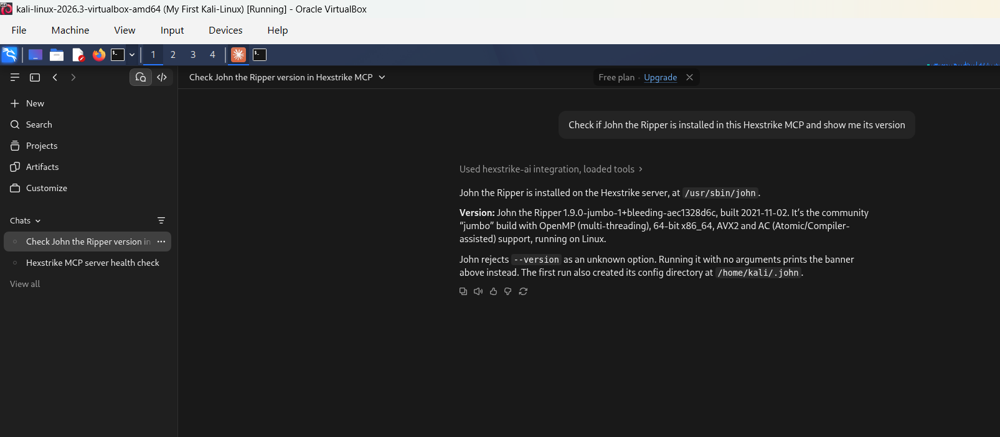
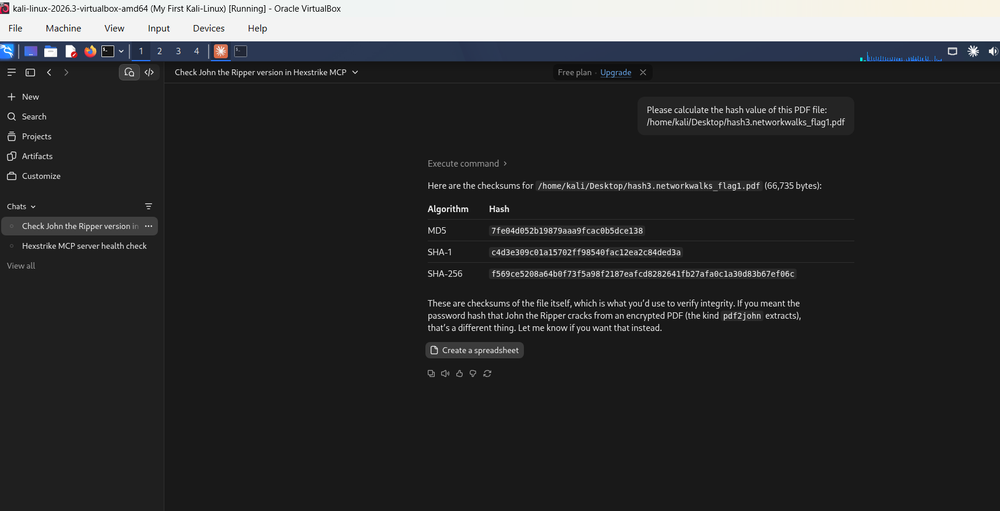

<div align="center">

# 🔐 Cybersecurity Week 3: Hash Extraction, Password Cracking & AI-Assisted Password Cracking with Claude & Hexstrike MCP


**Practicing password hash extraction, dictionary attacks, and AI-assisted password cracking in a controlled lab environment**

</div>

<p align="center">
  
  
  
  
  
  
  
  
  
  
  
  
  
</p>

---

# Disclaimer

All activities were performed using lab-provided sample files on an owned Windows system and an authorized VirtualBox lab environment for educational purposes.

No unauthorized access was performed.


---

# 📌 Project Overview

This lab focuses on practicing password hash extraction and dictionary-based password cracking using John the Ripper (JTR), Johnny GUI, and Networkwalks browser tools on Windows, alongside AI-assisted password cracking using Claude Desktop and the HexStrike-AI MCP server in Kali Linux. The goal is to extract cryptographic hashes from password-protected PDF files and recover their passwords in a safe and controlled lab environment.

These activities provide hands-on experience with how password protection works and why weak or common passwords pose a security risk. Using John the Ripper and browser-based hash extractors, hash values are retrieved from encrypted documents and tested against dictionary wordlists. For the AI-assisted module, the HexStrike-AI MCP server is integrated with Claude Desktop in Kali Linux to automate tool verification, hash calculation, and dictionary attacks through given natural language prompts.

All important tasks and screenshots are documented in this repository. Organizing the steps, outputs, and findings into a clear guide reinforces learning while demonstrating the importance of using strong, high-entropy passwords in future cybersecurity exercises.


# ✅Completed Modules

- 🗡️ **W3-PM1:** [Password Cracking with JTR](#module-️---w3-pm1-password-cracking-with-jtr)

- 🔓 **W3-PM2:** [Password Cracking with Networkwalks Tools](#module----w3-pm2-password-cracking-with-networkwalks-tools)
- 🔆 **Additional Module:** [JTR Password Cracking Lab with Claude & Hexstrike MCP](#module----additional-module-jtr-password-cracking-lab-with-claude--hexstrike-mcp)

---


# 🎯 Objectives

The main objectives of this project are to:

- Download, install, and configure John the Ripper (JTR CLI) and Johnny (GUI) on Windows for local password auditing.
- Extract the cryptographic hashes from three encrypted PDF lab files using Online Hash Extractor and save them in a text file format.
- Recover the passwords for all three locked PDF files using Johnny GUI and verify access by unlocking each document.
- Extract PDF password hashes locally in the browser using the Networkwalks Hash Calculator and recover the passwords for three encrypted PDF files using the Networkwalks Password Cracker with the default in-built wordlist (or custom wordlists).
- Install Claude Desktop on Kali Linux and set up the HexStrike-AI MCP server inside a Python virtual environment.
- Configure the MCP server connection in Claude Desktop and verify server health for AI-assisted tasks.
- Use prompts in Claude Desktop with HexStrike MCP and the `rockyou.txt` wordlist to calculate file hashes and crack the passwords of two encrypted PDF lab files using John the Ripper.
- Document all steps, configurations, prompts, and screenshots from the completed modules to reinforce practical understanding of password security.

---

# 🛡️ Purpose of the Lab

The lab provides a safe and controlled environment where hash extraction and password cracking can be practiced without affecting real accounts or unauthorized files.

Possible uses of the lab include:

- Extracting cryptographic password hashes from protected PDF documents
- Testing password strength using local CLI and GUI auditing tools like John the Ripper and Johnny
- Performing dictionary-based password recovery using browser-based tools and custom wordlists
- Setting up and configuring AI-assisted environments using MCP servers and Claude Desktop
- Automating hash calculation and wordlist attacks through natural language prompts
- Evaluating password complexity and practicing defensive cybersecurity techniques
---

# 🏗️ Lab Architecture

* **Windows 11 Host Machine:** Used with John the Ripper (JTR CLI), Johnny (GUI), Online Hash Crack PDF Hash Extractor, and Networkwalks browser tools (Hash Calculator and Password Cracker) for hash extraction and dictionary-based password recovery across the modules (**W3-PM1** and **W3-PM2**).

* **Kali Linux Virtual Machine (VirtualBox):** Used to deploy the HexStrike-AI MCP server (`http://localhost:8888`) inside a Python virtual environment (`hexstrike-env`) and integrate it with Claude Desktop for AI-assisted hash calculation and password cracking using John the Ripper.


*Figure 1: Week 3 Lab Architecture*


---

# 🪜 Lab Setup Procedure

## Module 🗡️ - W3-PM1: Password Cracking with JTR

**Steps In Order:**

1. **Download John the Ripper and Johnny GUI:** Download and extract John the Ripper (`john-1.9.0-jumbo-1-win64`) and the Johnny GUI from the official Openwall website and install Johnny on the Windows host machine. If the main download is slow, use the official Openwall mirror directory below:
   * Open public directory for John the Ripper downloading: https://distro.ibiblio.org/openwall/projects/john/1.9.0/

2. **Link the John the Ripper Executable:** Open Johnny GUI, navigate to **Settings**, click **Browse**, and select the `john.exe` executable located inside the extracted `run` folder.

3. **Download the Encrypted Lab Files:** Download the three password-protected PDF files required for the lab (`My Locked PDF1`, `My Locked PDF2`, and `My Locked PDF3`) onto the local Windows machine. The three encrypted files can be downloaded from lab page here below:

    * Lab Page: https://networkwalks.com/project-task-lab-password-cracking-with-networkwalks-tools/ 

4. **Extract and Save the PDF Hash:** Open the Online PDF Hash Extractor, upload `My Locked PDF1`, and copy the resulting hash string (making sure it starts cleanly with `$pdf$`). Paste the hash into Notepad and save it as `hash1.txt`.


*Figure 2: My Locked PDF1 Hash Extractor*


5. **Load the Hash File in Johnny GUI:** Return to Johnny GUI, click **Open password file**, browse to the saved `hash1.txt` file, and open it.


*Figure 3: My Locked PDF1 initial image from Johnny GUI*

6. **Run the Cracking Attack:** Click **Start new attack** in the top toolbar of Johnny GUI and wait for the tool to recover the password.


*Figure 4: My Locked PDF1 password cracked from Johnny GUI*

7. **Unlock the Encrypted PDF:** Copy the cracked password from Johnny GUI, open `My Locked PDF1`, paste the password into the password prompt, and submit it to unlock and view the PDF.


*Figure 5: My Locked PDF1 password unlocked*

8. **Repeat for Remaining Files:** Repeat Steps 4 through 7 for both `My Locked PDF2` and `My Locked PDF3` (saving their hashes into separate text files) until all three encrypted PDFs are unlocked. 

---

## Module 🔓 - W3-PM2: Password Cracking with Networkwalks Tools

**Steps In Order:**

1. **Download the Encrypted Lab Files:** Download `My Locked PDF1 (for NW Tools Lab WK3-PM2)` along with `My Locked PDF2` and `My Locked PDF3` onto the local Windows machine.

2. **Extract the Hash Using Networkwalks Hash Calculator:** Open the Networkwalks Hash Calculator in a web browser (`https://networkwalks.com`), upload `My Locked PDF1 (for NW Tools Lab WK3-PM2)`, and copy the complete `$pdf$` hash value generated.


*Figure 6: Hash Calculator*


 Module 2 From Hash Calculator.png>)
*Figure 7: Hash Output*


3. **Crack the Password Using Networkwalks Password Cracker:** Open the Networkwalks Password Cracker (`https://networkwalks.com`), paste the copied `$pdf$` hash into the input box, and click **START CRACKING** using the default **built-in list (100 words)** to recover the password.
   * *Note:* Testing can also be achieved by uploading a custom wordlist like the `JTR_default_password.txt` (3,556 words).


*Figure 8: Password cracker with default wordlist*

 Module 2 From Password Cracker-1.png>)
*Figure 9: Password revealed for the My Locked PDF1 (for NW Tools Lab WK3-PM2).pdf*


4. **Unlock and Verify the PDF:** Copy the cracked password, open `My Locked PDF1 (for NW Tools Lab WK3-PM2)`, and enter the password to unlock and verify the file.

 Module 2 Unlocked.png>)

*Figure 10: Result of My Locked PDF1 (for NW Tools Lab WK3-PM2) using NW (Networkwalks) Tools*


5. **Repeat for Remaining Files:** Repeat Steps 2 through 4 for both `My Locked PDF2` and `My Locked PDF3` in the Networkwalks Hash Calculator and Password Cracker to confirm all three passwords were recovered and verified.

---


## Module 🔆 - Additional Module: JTR Password Cracking Lab with Claude & HexStrike MCP

**Steps In Order:**

### Task 1: Setting Up HexStrike-AI MCP Server with Claude Desktop

1. **Launch Kali Linux:** Open Kali Linux within VirtualBox.

2. **Install Claude Desktop:** Open the VM Terminal located at the top of the screen and enter these commands in order to add the GPG key, configure the APT repository, and install Claude Desktop. Can also refer to the Download Claude Desktop and HexStrike-AI GitHub Repository (listed in the Tools & Resources section at the bottom of this readme file) for any guidance.

```bash

# Add the GPG key

curl -fsSL https://pkg.claude-desktop-debian.dev/KEY.gpg | sudo gpg --dearmor -o /usr/share/keyrings/claude-desktop.gpg

# Add the repository

echo "deb [signed-by=/usr/share/keyrings/claude-desktop.gpg arch=amd64,arm64] https://pkg.claude-desktop-debian.dev stable main" | sudo tee /etc/apt/sources.list.d/claude-desktop.list

# Update packages and install Claude Desktop

sudo apt update

sudo apt install claude-desktop

```


*Figure 11: Intial steps of Claude desktop setup*

3. **Sign In to Claude Desktop:** Once Claude Desktop is installed, open it from the Applications menu and complete the account sign-in process.

4. **Download HexStrike MCP and Install Dependencies:** In the Kali terminal, clone the `hexstrike-ai` repository, create and activate a Python virtual environment (`hexstrike-env`), and install the required Python packages:

```bash

# 1. Clone the repository and enter the folder

git clone https://github.com/0x4m4/hexstrike-ai.git

cd hexstrike-ai

# 2. Create and activate the Python virtual environment

python3 -m venv hexstrike-env

source hexstrike-env/bin/activate

# 3. Install the required Python dependencies (using ~/pip-tmp to prevent /tmp RAM disk exhaustion)

mkdir -p ~/pip-tmp

TMPDIR=~/pip-tmp pip3 install --no-cache-dir -r requirements.txt

rm -rf ~/pip-tmp

```


*Figure 12: A step before the Hexstrike command*

5. **Start the HexStrike Server:** Keep the virtual environment active and run `hexstrike_server.py` to launch the HexStrike API server on `http://localhost:8888`:

```bash

# Go to the folder, activate the Python environment, and launch the HexStrike server

cd ~/hexstrike-ai

source hexstrike-env/bin/activate

python3 hexstrike_server.py
```


*Figure 13: Hexstrike initial banner*


6. **Configure the MCP Server in `claude_desktop_config.json`:** Open **Settings → Desktop app → Extensions** in Claude Desktop and click **Edit config** under **Local MCP servers** to locate the configuration file, then write the `mcpServers` JSON configuration directly into `~/.config/Claude/claude_desktop_config.json` from a new terminal tab so it is saved cleanly:

```bash
cat << 'EOF' > ~/.config/Claude/claude_desktop_config.json
{
  "mcpServers": {
    "hexstrike-ai": {
      "command": "/home/kali/hexstrike-ai/hexstrike-env/bin/python",
      "args": [
        "/home/kali/hexstrike-ai/hexstrike_mcp.py",
        "--server",
        "http://localhost:8888"
      ]
    }
  }
}
EOF
```


*Figure 14: Edit Config*


*Figure 15: JSON file Part 1*


*Figure 16: JSON file Part 2*


*Figure 17: JSON file Part 3*


7. **Restart Claude Desktop and Verify the Server:** Force-close Claude Desktop (`pkill -9 -f claude`) so it reloads the updated configuration, reopen it, and confirm `hexstrike-ai`. Another way to verify is under **Settings → Desktop app → Extensions** where you see hexstrike running. Thirdly, a checkmark under **Settings → Customize → Connectors** (as well as verifying the `HTTP 200` health check response in the HexStrike server terminal).


*Figure 18: Verified via Desktop app*


*Figure 19: Verified via Customize -> Connectors*

8. Open a new chat in Claude Desktop and test the quality of the server connection by sending the prompt below.


> please check the health of this hexstrike MCP server.


*Figure 20: Server health*


*Figure 21: Server health Continued*


---


### Task 2: AI-Assisted Password Cracking with John the Ripper

1. **Transfer the Encrypted File to Kali Linux:** Take the encrypted lab file `My Locked PDF1 (for NW Tools Lab WK3-PM2)`, rename it to `hash3.networkwalks_flag1.pdf` on the Windows host machine, and move it to the Kali Linux VM environment using VirtualBox's **Drag and Drop** feature:
   * From the top menu bar of VirtualBox, click **Devices → Drag and Drop → Bidirectional**.
   * Drag `hash3.networkwalks_flag1.pdf` directly from Windows onto the Kali Linux Desktop.
   * Verify that the file is saved inside `/home/kali/Desktop/` using the Kali Linux file manager or terminal.

2. **Ensure the HexStrike MCP Server is Running:** Before sending prompts in Claude Desktop, confirm that the HexStrike API server is active in the Kali terminal (run these commands every time if the server is not already running):

```bash

cd ~/hexstrike-ai

source hexstrike-env/bin/activate

python3 hexstrike_server.py

```

*Figure 22: Started HexStrike-AI MCP Server*


3. **Execute Natural Language Prompts in Claude Desktop:** Open Claude Desktop on Kali Linux and enter the following three prompts in order to verify John the Ripper, extract the hash of `hash3.networkwalks_flag1.pdf`, and crack the password using the `rockyou.txt` wordlist—confirming that the recovered password matches the expected result from the previous modules:

   * **Natural Language Prompt 1 (Verify JTR Installation):**
     > Check if John the Ripper is installed in this Hexstrike MCP and show me its version


     
     *Figure 23: Natural Language Prompt 1*

   * **Natural Language Prompt 2 (Calculate File Hash):**
     > Please calculate the hash value of this PDF file: /home/kali/Desktop/hash3.networkwalks_flag1.pdf


     
     *Figure 24: Natural Language Prompt 2*


   * **Natural Language Prompt 3 (Crack Password Using `rockyou.txt`):**
     > Please use JTR tool in this hexstrike MCP server to crack the password of this PDF file. Use the rockyou.txt wordlist dictionary.


     
     *Figure 25: Natural Language Prompt 3*


4. **Repeat for Additional Encrypted Files:** Repeat Steps 1 and 3 for any other password-protected files (such as encrypted PDF, ZIP, or Office documents). Below is the result for `hash3.networkwalks_flag3.pdf` (renamed from `My Locked PDF3.pdf`), which also matched the recovered password obtained in Modules 1 and 2:


*Figure 26: hash3.networkwalks_flag3.pdf result*


---


# 🐞 Problems Encountered & Solutions

### Problem 1. Terminal Interruption and Dependency Resolution Delays

An interrupted terminal session during `requirements.txt` installation caused extended version resolution loops for `angr`. I resolved this by reactivating the virtual environment and letting `pip` finish unhindered.

```bash

cd ~/hexstrike-ai

source hexstrike-env/bin/activate

pip3 install -r requirements.txt

```

### Problem 2. Temporary Storage Exhaustion (`Errno 28: No space left on device`)
Heavy package compilations filled up the `/tmp` RAM disk (`tmpfs`) despite having free disk space on root. I fixed this by clearing caches and redirecting the build directory to the main hard drive.

```bash

# Checks how much free space is left on main hard drive

df -h /

# Deletes all stored Python package installation files to free up space.

pip3 cache purge

# Deletes downloaded system update and installation files that are no longer used.

sudo apt clean

# Creates a new temporary folder inside your personal home directory on the main hard drive.

mkdir -p ~/pip-tmp

# Installs your Python packages using that new hard drive folder for temporary files instead of your full RAM disk, without saving a backup cache

TMPDIR=~/pip-tmp pip3 install --no-cache-dir -r requirements.txt

# Deletes the temporary folder and everything inside to clean up after the installation finishes

rm -rf ~/pip-tmp
```

### Problem 3. Claude Desktop UI Differences and Background System Tray Behavior
Updated Claude Desktop UI layouts relocated local MCP settings and minimized to the system tray on close instead of exiting. I navigated the new menus and forcefully terminated the background process via terminal.

```bash

pkill -f claude

pkill -9 -f claude

```

### Problem 4. Local MCP Server Not Appearing After Using Edit Config
Using the UI config editor left the JSON file populated only with internal preferences rather than the `mcpServers` block. I resolved this by overwriting the configuration file directly and restarting the app.

```bash
cat << 'EOF' > ~/.config/Claude/claude_desktop_config.json
{
  "mcpServers": {
    "hexstrike-ai": {
      "command": "/home/kali/hexstrike-ai/hexstrike-env/bin/python",
      "args": [
        "/home/kali/hexstrike-ai/hexstrike_mcp.py",
        "--server",
        "http://localhost:8888"
      ]
    }
  }
}
EOF
```

### Problem 5. Optional Tool Probe Warnings During Server Health Check
Initial health checks flagged exit code warnings for missing optional utilities like `ghidra` and `prowler`. I verified the core health response and confirmed that essential password tools remained fully functional.


---


# 💡 What I Learned

The most important concepts I learned from this project involved understanding how password hashes work, how quickly weak passwords can be recovered, and how important it is to use strong passwords, as follows:

### 1. John the Ripper & Johnny GUI and Their Importance
In today's digital environment, ensuring that accounts and sensitive files are not compromised requires creating strong, complex passwords. By working with password auditing tools such as John the Ripper (CLI) and its graphical interface, Johnny GUI, I saw how easily short or common passwords can be recovered once a file's hash is extracted. Practicing with these tools in a controlled lab demonstrates why organizations and everyday users must avoid predictable passwords and rely on long and complex ones instead.

### 2. Understanding Hash Formats, Wordlists, and Password Strength
Through extracting hashes from multiple encrypted PDF files across Modules 1 and 2, I learned that cryptographic hashes act as unique digital fingerprints (`$pdf$` strings) rather than reversible encrypted text. Even small formatting details such as ensuring no extra characters like `b'` are copied alongside the hash impacts whether a cracking tool can properly read and test the hash. Additionally, comparing the built-in 100-word list, the `JTR_default_password.txt` wordlist (3,556 words), and the `rockyou.txt` dictionary showed me how wordlist size and password complexity directly determine whether a dictionary attack succeeds in seconds or fails completely.

### 3. HexStrike MCP Server and the Influence of AI in Cybersecurity
Setting up the HexStrike-AI MCP server with Claude Desktop in Kali Linux showed me how artificial intelligence is changing security workflows. Instead of manually typing every command-line flag for tool checks, hash extraction, and wordlist attacks, connecting an LLM to local security tools via the Model Context Protocol (MCP) allows those tasks to be performed through clear natural language prompts. At the same time, troubleshooting dependency conflicts, `/tmp` storage limits, and JSON configuration files taught me that AI-assisted tools still depend on proper Linux administration, careful verification, and strong underlying system setup.


---


# 🔗 Tools & Resources

- **John the Ripper (Public Directory):** [https://distro.ibiblio.org/openwall/projects/john/1.9.0/](https://distro.ibiblio.org/openwall/projects/john/1.9.0/)
- **John the Ripper (Official Website):** [https://www.openwall.com/john/](https://www.openwall.com/john/)
- **Johnny GUI:** [https://openwall.info/wiki/john/johnny](https://openwall.info/wiki/john/johnny)
- **PDF Hash Extractor:** [https://www.onlinehashcrack.com/tools-pdf-hash-extractor.php](https://www.onlinehashcrack.com/tools-pdf-hash-extractor.php)
- **Networkwalks Hash Calculator:** [https://networkwalks.com/hash-calculator/](https://networkwalks.com/hash-calculator/)
- **Networkwalks Password Cracker:** [https://networkwalks.com/password-cracker/](https://networkwalks.com/password-cracker/)

- **Download Claude Desktop:** [https://github.com/aaddrick/claude-desktop-debian](https://github.com/aaddrick/claude-desktop-debian)

- **HexStrike-AI GitHub Repository:** [https://github.com/0x4m4/hexstrike-ai](https://github.com/0x4m4/hexstrike-ai)

- **7-Zip:** [https://7-zip.org/download.html](https://7-zip.org/download.html)

- **VirtualBox:** [https://virtualbox.org/wiki/Downloads](https://virtualbox.org/wiki/Downloads)
- **Kali Linux:** [https://kali.org/get-kali](https://kali.org/get-kali)


---

# 👤 Author

**Merin Jayeson**\
Cybersecurity Intern B084


LinkedIn: [Merin Jayeson's LinkedIn](https://www.linkedin.com/in/merinjayeson/)

---

## 📌 Project Information

**Program Name:** Cybersecurity at Networkwalks | **Week:** 03 | **Project:** Hash Extraction, Password Cracking & AI-Assisted Password Cracking with Claude & Hexstrike MCP | **Repository:** GitHub